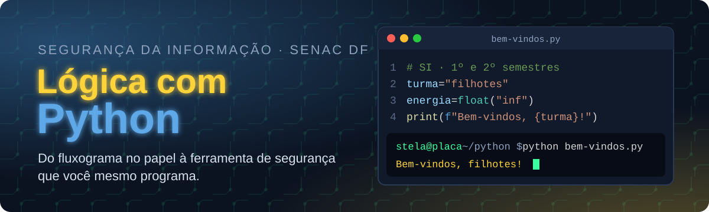

<p align="center">
  
</p>

<p align="center">
  
  
  
  
</p>

<p align="center">
  <b><a href="https://maristelaoliveira.github.io/Python-Logica/">🌐 Abrir o site da disciplina</a></b>
  &nbsp;·&nbsp;
  <b><a href="https://maristelaoliveira.github.io/Python-Logica/#aulas">📚 Ir direto para as aulas</a></b>
  &nbsp;·&nbsp;
  <b><a href="https://maristelaoliveira.github.io/Python-Logica/quiz/">🕹️ Jogar o PyQuiz</a></b>
</p>

---

## `>>> import this`

Prazer, eu sou a **Profa. Maristela**, ou só **Stela**! 👋

Boas-vindas à **Lógica de Programação com Python**, do curso de **Segurança da Informação** da Faculdade de Tecnologia e Inovação Senac DF (1º e 2º semestres, manhã, 70 horas).

Este repositório é o **site da disciplina**: o lugar onde ficam as aulas, os tutoriais, os exercícios, as atividades e tudo o que a gente usa no semestre. Nada de slides: aqui a aula é o próprio site.

```python
>>> turma = "filhotes"
>>> energia = float("inf")
>>> print(f"Bem-vindos, {turma}!")
Bem-vindos, filhotes!
```

> 🐍 Curiosidade: o nome vem do grupo de humor **Monty Python**, não da cobra. A cobra só chegou depois, e ficou.

---

## 🧭 O que tem no site

| | Seção | Para que serve |
|:-:|---|---|
| 🔬 | **Raio-X do Python** | O que é a linguagem, por que ela é a nº 1 e por que quem trabalha com segurança adora. |
| 📜 | **Ementa** | Os objetivos e as cinco unidades do semestre. |
| 📚 | **Aulas** | Uma página por encontro, com conceitos, tutorial passo a passo, desafio e checklist. |
| 🧪 | **Exercícios no navegador** | Você escreve Python na própria página, clica em testar e vê na hora o que passou. |
| 🏅 | **Medalhas** | Bronze, prata e ouro em cada exercício resolvido. Colecione todas. 😎 |
| 🕹️ | **PyQuiz** | 30 questões de revisão do 1º bimestre, num visual hacker, com explicação em cada resposta. |
| 🚨 | **Plantão de segurança** | A atividade remota: cinco exercícios que rodam e se corrigem sozinhos. |
| 📊 | **Avaliação** | Como a nota é montada nos dois bimestres. |

---

## 🗺️ A trilha do semestre

Cinco unidades, uma ferramenta de segurança no fim. Em Python, fica assim:

```python
trilha = [
    "Unidade 1 · pensar como o computador (algoritmos e fluxogramas)",
    "Unidade 2 · o primeiro olá (variáveis, tipos, entrada e saída)",
    "Unidade 3 · decidir e repetir (if, while e for)",
    "Unidade 4 · listas, dicionários e funções",
    "Unidade 5 · código limpo, erros tratados e projeto final",
]

for passo, unidade in enumerate(trilha, start=1):
    print(f"{passo}. {unidade}")

print("🏁 Ferramenta de segurança funcionando!")
```

| Aula | Tema | |
|:-:|---|:-:|
| 01 | Conhecendo a disciplina e o pensamento computacional | [abrir](https://maristelaoliveira.github.io/Python-Logica/aulas/aula-01.html) |
| 02 | O que é um algoritmo? | [abrir](https://maristelaoliveira.github.io/Python-Logica/aulas/aula-02.html) |
| 03 | Desenhando a lógica com fluxogramas | [abrir](https://maristelaoliveira.github.io/Python-Logica/aulas/aula-03.html) |
| 04 | Meu primeiro programa em Python | [abrir](https://maristelaoliveira.github.io/Python-Logica/aulas/aula-04.html) |
| 05 | Variáveis, tipos e entrada de dados | [abrir](https://maristelaoliveira.github.io/Python-Logica/aulas/aula-05.html) |
| 06 | Operadores e expressões | [abrir](https://maristelaoliveira.github.io/Python-Logica/aulas/aula-06.html) |
| 07 | Como um sistema decide quem pode entrar? (`if`) | [abrir](https://maristelaoliveira.github.io/Python-Logica/aulas/aula-07.html) |
| 08 | Revisão e atividade avaliativa prática | [abrir](https://maristelaoliveira.github.io/Python-Logica/aulas/aula-08.html) |
| 09 | Avaliação do 1º bimestre | [abrir](https://maristelaoliveira.github.io/Python-Logica/aulas/aula-09.html) |
| 10 | Repetindo até acertar: `while` | [abrir](https://maristelaoliveira.github.io/Python-Logica/aulas/aula-10.html) |
| 11 | Repetição com `for` e `range()` | [abrir](https://maristelaoliveira.github.io/Python-Logica/aulas/aula-11.html) |
| 12 | Strings: validando senhas e cifrando mensagens | [abrir](https://maristelaoliveira.github.io/Python-Logica/aulas/aula-12.html) |
| 13 a 18 | Listas, dicionários, funções, projeto final e encerramento | em breve |

---

## 🧪 Python rodando dentro do navegador

Nas aulas com exercícios, você escreve o código na própria página. **Executar** roda o seu programa; **Verificar** confere a resposta com os testes. Um Python de verdade (o [Pyodide](https://pyodide.org/)) roda escondido no seu navegador:

```text
⚡ Curto-circuito. 3 de 5 testes passaram. Confere a trilha e tenta de novo.

   ... ajusta, verifica de novo ...

✅ Compilou de primeira! Todos os 5 testes passaram.   🥇
```

Errou? Ótimo: a mensagem de erro diz a linha e quase sempre dá a dica. Lê com calma, corrige e testa de novo. 🔁

---

## 🛠️ Ferramentas da disciplina

<p align="center">
  
</p>

| Ferramenta | Para quê |
|---|---|
| 🧭 **Flowgorithm** e **Whiteboard** | Desenhar o algoritmo antes de programar. |
| 🐍 **Python** no **VS Code** | Escrever e executar os programas. |
| 🎓 **NetAcad · Python Essentials** | A trilha que acompanha a disciplina e prepara para a certificação **PCEP**. |
| 🐙 **GitHub** | Guardar e entregar os seus projetos. |
| 💬 **Teams, Loop e Whiteboard** | Combinar, tirar dúvida e trabalhar junto. |
| 🤖 **IA** (Copilot) | Para explicar e revisar código, com senso crítico. |

> 🤖 **IA com consciência:** a IA ajuda, mas quem entende o código é você. E tem dia **sem IA**, para você ver o quanto já anda sozinho. 💪

---

## 📊 Como a nota é montada

| 1º bimestre (10 pontos) | | 2º bimestre (10 pontos) | |
|---|:-:|---|:-:|
| Prova objetiva | 6,0 | Apresentação do projeto final | 7,0 |
| Atividade avaliativa prática | 4,0 | Avaliação Integrada | 2,0 |
| | | Jornada Interdisciplinar | 1,0 |

Para ser aprovado: **média final 6,0** e pelo menos **75% de frequência**.

```text
Traceback (most recent call last):
  File "semestre.py", line 18, in <module>
    aprovar(aluno)
FaltaError: frequência abaixo de 75%
```

> Esse erro a gente não quer ver. Venha às aulas! 😉

---

## 🙋 Dicas de sobrevivência

1. **Pense antes de digitar.** O algoritmo primeiro, o código depois.
2. **Leia a mensagem de erro.** Ela não é bronca: é um mapa.
3. **Teste de propósito com dado errado.** Senha vazia, número negativo, letra no lugar de número.
4. **Indentação importa.** Em Python, quatro espaços mudam tudo.
5. **Travou?** Pergunte no Teams. Ninguém nasce sabendo `while True`.

---

<details>
<summary><b>👩‍🏫 Para a professora (estrutura do repositório)</b></summary>

<br>

Site estático publicado no GitHub Pages a partir da branch `main`, sem build e sem dependências.

```text
Python-Logica/
├── index.html                # página da disciplina (raio-x, ementa, aulas, avaliação, atividades)
├── aulas/
│   ├── aula-NN.html          # uma página por aula
│   └── aula-NN-testes.js     # os testes dos exercícios da aula (window.TESTES)
├── atividade-remota/         # Plantão de segurança: exercícios que se corrigem sozinhos
├── quiz/                     # PyQuiz: revisão do 1º bimestre (perguntas em script.js)
└── assets/
    ├── css/  js/             # visual comum dos sites da Stela; python-exercicios.js e python-worker.js (Pyodide)
    └── img/                  # ícones, logo e o banner deste README
```

- Exercício novo: o `article.exercicio` na página da aula e os testes em `aulas/aula-NN-testes.js`.
- Pergunta nova no PyQuiz: a constante `QUESTIONS`, no começo de `quiz/script.js`.
- Antes de publicar: testar no navegador, também na largura de celular (390 px).

</details>

---

<p align="center">
  Feito com ♥ e sucata eletrônica pela <a href="https://maristelaoliveira.github.io/">Profa. Maristela</a> · Faculdade de Tecnologia e Inovação Senac DF
  <br>
  <code>print("bons estudos!")</code>
</p>
